<!--
  README do perfil de Enzo Rodrigues, no estilo do macOS.
  As imagens de assets/ saem dos scripts de scripts/:
    perfil.py        desenha a área de trabalho do topo e os botões (rode depois de mudar os textos)
    plataformas.py   desenha o diagrama "um código, três plataformas"
    contribuicoes.py busca as contribuições pela API do GitHub
    grafico.py       desenha o gráfico de contribuições
  O gráfico é atualizado todo dia pelo workflow .github/workflows/atualizar-grafico.yml.
  A área de trabalho e o gráfico têm versão clara e escura; o <picture> escolhe conforme o tema
  de quem visita. O diagrama é azul nos dois temas.
-->

<picture>
  <source media="(prefers-color-scheme: dark)" srcset="./assets/desktop-dark.svg" />
  <source media="(prefers-color-scheme: light)" srcset="./assets/desktop-light.svg" />
  
</picture>

## Enzo Rodrigues

**Desenvolvedor Full-stack & Mobile na GN Solutions · iOS, React Native, TypeScript, Python**

Apps para iPhone, Android e web, do banco de dados até a App Store, com agentes de IA no fluxo de trabalho.

  

## Sobre mim

Sou desenvolvedor Full-stack & Mobile na [GN Solutions](https://gnsolutions.com.br), empresa de tecnologia e IA, e curso Análise e Desenvolvimento de Sistemas no IFSP. Trabalho de ponta a ponta: modelo o banco, escrevo a API, construo o app e cuido do caminho até a produção, seja uma VPS ou a App Store.

Na GN, trabalho nos produtos da casa: o MoneyFin AI, app de finanças pessoais publicado na App Store; o Clerum, plataforma de gestão para igrejas; e o UpKeeper, sistema de manutenção e ativos em produção para vários clientes. Também cuido das ferramentas que mantêm os projetos saudáveis: design system, quality gate no CI, monitoramento da infraestrutura e o padrão de commits e releases do time.

Uso IA como ferramenta de engenharia, não só como autocomplete. Crio meus próprios agentes, skills e mods para o Claude Code (revisão de PR, auditoria de segurança, testes, deploy iOS) e estou construindo uma IDE nativa para macOS que coloca vários agentes de código para trabalhar em paralelo.

## O que eu faço

- Apps para iOS e Android com React Native e Expo: login com Apple e Google, assinaturas in-app, updates OTA e publicação pela EAS.
- Plataformas web com React e Node.js ou Python/Flask, PostgreSQL, pagamentos com Stripe e recursos de IA.
- Deploy por tag, CI no GitHub Actions e infraestrutura própria com Docker, Traefik e VPS, monitorada com Grafana, Prometheus e Loki.
- Ferramentas para o time: design system, quality gate com ratchet de métricas, releases automáticas e agentes de IA no fluxo de PR.

**Domino:** TypeScript, React, React Native, Expo, Node.js, Python, Flask, PostgreSQL, Drizzle, SQLAlchemy, Swift, SwiftUI, Docker e GitHub Actions.

**Stacks que uso nos projetos:** Expo Router, TanStack Query, Tailwind, shadcn/ui, Express, Next.js, Vite, Stripe, API da OpenAI, Resend, Open Finance (Pluggy), Sentry, EAS, Traefik, Grafana, Prometheus e Loki.

**IAs que uso no dia a dia:** Claude Code e Codex.

## Projetos em destaque

- **[MoneyFin AI](https://moneyfin.ai)** · Controle financeiro pessoal com IA: contas, cartões, orçamentos, metas, assistente e sincronização bancária via Open Finance. Versão web e app na [App Store](https://apps.apple.com/br/app/moneyfin-ai/id6761278897). Sou o principal desenvolvedor do app e do web. Stack: React, Node.js, Express, PostgreSQL, Drizzle, Stripe, API da OpenAI · app em Expo e React Native, com compras in-app e OTA
- **[Clerum](https://clerum.ai)** · Plataforma de gestão para igrejas: membros, finanças, escalas, eventos e comunicação com a comunidade. Deploy por tag, com mais de 120 releases. O app do tesoureiro, em Expo, está em desenvolvimento. Stack: TypeScript, React, Express, PostgreSQL, Drizzle, Stripe, API da OpenAI, Docker, Traefik
- **[upkeeper](https://upkeeper.com.br)** · Gestão de manutenção, patrimônio e ordens de serviço, multi-tenant e em produção: abertura de OS por QR code, relatórios em PDF, leitura de checklist por foto e interface em português e espanhol. Hoje também desenho a próxima versão, em TypeScript. Stack: Python, Flask, SQLAlchemy, Alembic, PostgreSQL, Docker, Traefik
- **TTES** · Projeto pessoal: IDE nativa para macOS que roda agentes de código (Claude Code e Codex) em paralelo, um git worktree por tarefa. Os terminais dos agentes continuam vivos mesmo com o app fechado. Stack: Swift 6, SwiftUI, AppKit, SwiftTerm, GRDB
- **GN Quality Gate** · Ratchet de métricas no CI: nenhum PR pode piorar erros de lint e de tipos, duplicação ou tamanho de arquivo, e a cobertura só sobe. Roda como GitHub Action e como plugin do Claude Code nos projetos da GN. Stack: Node.js, GitHub Actions, ESLint, tsc, Vitest, jscpd, osv-scanner
- **Ferramentas do time** · Design system com tokens e componentes compartilhados entre os produtos, plugin de commits semânticos com releases automáticas e monitoramento da infraestrutura como código. Stack: React, Tailwind, tsup, Docker Compose, Grafana, Prometheus, Loki
- **Sites e sistemas sob demanda** · Sites institucionais e ferramentas internas para empresas. Stack: Next.js, React, Vite, Tailwind, shadcn/ui, Sanity, PostgreSQL

## Contato

<a href="https://www.linkedin.com/in/enzo-rodrigues/">LinkedIn</a> · <a href="mailto:enzorodrigues272@gmail.com">enzorodrigues272@gmail.com</a> · <a href="https://www.instagram.com/_enzooyy_/">Instagram @&#95;enzooyy&#95;</a> · <a href="https://gnsolutions.com.br">GN Solutions</a>

<!-- gráfico de contribuições, atualizado pelo workflow diário -->
<picture>
  <source media="(prefers-color-scheme: dark)" srcset="./assets/contrib-dark.svg" />
  <source media="(prefers-color-scheme: light)" srcset="./assets/contrib-light.svg" />
  
</picture>

<i>Se quiser conversar sobre apps, IA ou engenharia de software, é só me chamar.</i>

